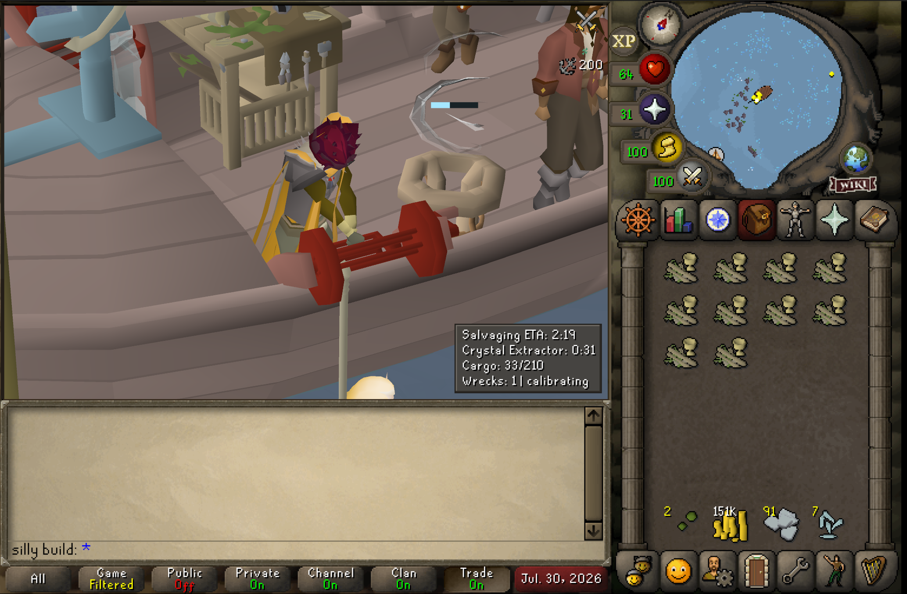
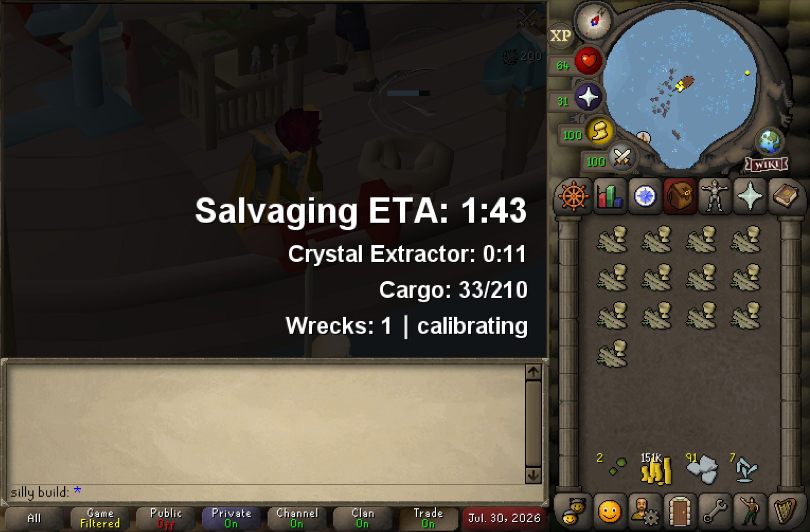
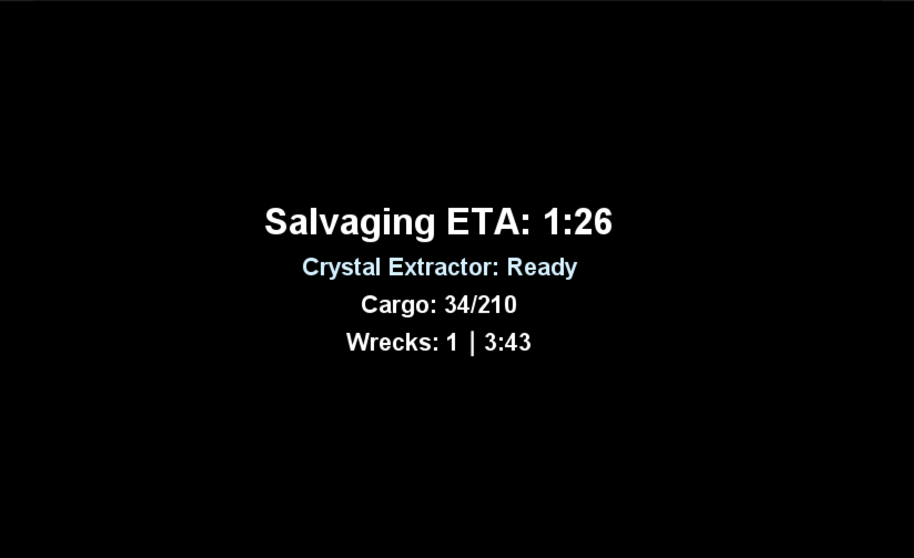

# Salvaging AFK Timer

A configurable salvaging AFK timer and dimmer for cozy sailing gains.

**For best results and most accurate shipwreck timings, please use this plugin on a dedicated salvaging world.**

## Features

- Highly configurable text overlays displaying action progress ETAs, Crystal Extractor status, cargo capacity & local wreck tracking information.
- Optional dimmer, activated when salvaging and sorting to minimise distraction - perfect for second monitor/altscape!
- Tries its best to keep track of shipwrecks! Please use an official salvaging world for better results.

## Sample Setups
_"Minimalist text box" mode_

_"Timer and dimmer overlay with undim interfaces"_

_"Timer and dimmer overlay"_

## Settings Panel Explained

- Toggle Hotkey - Allows the user to select a hotkey to turn the plugin on or off
- Toggle only hides dimmer - Allows the user to toggle the dimmer with a hotkey, without hiding text/timer overlays

**"Distraction Dimmer"**
- **Dimmer colour & opacity** - Configuration for the dimmer overlay
- **Dim when salvaging -** Shows the dimmer overlay when the player is performing a salvaging animation
- **Dim when sorting -** Shows the dimmer overlay when the player is performing a sorting animation
- **Undim sooner when sorting/Sorting undim seconds -** Allows for the dimmer overlay to be configured to disappear before sorting is finished by some given seconds
- **Unhide chat -** Unhides the chatbox when the dimmer is active
- **Unhide interfaces -** Unhides interfaces such as world map and inventory when the dimmer is active

**"Timer Overlay"**
- **Show timer overlay -** Displays the timer text overlay
- **Minimalist text box -** Enables a minimalist, game-themed summary of the same information
- **Only show text when dimmed -** Only displays the text overlay when the dimmer is active
- **Show salvaging ETA -** Displays an estimate until your character stops salvaging, based on estimated salvage rates and the lifetime of the ships around your character.
- **Show sorting ETA -** Displays a countdown until your character finishes sorting.
- **Show wreck timer -** Displays, to our best knowledge, the lifespans of the two shipwrecks closest to the player
- **Show cargo -** Displays our very best estimate of the contents and capacity of your cargo hold
- **Show background, background colour & opacity -** Shows a configurable background behind the text
- **ETA text size, text size, colour & alignment -** Configuration settings for text overlay 

**"Crystal Extractor"**
- **Show crystal extractor -** Shows the crystal extractor status in the text overlay
- **Pulse when extractor ready -** Causes the crystal extractor status text to non-invasively pulse in a light blue colour when ready.
- **Extractor pulse speed -** Sets the speed of the pulse
- **Undim when extractor ready -** Disables the dimmer overlay when the crystal extractor is ready

**"Tracking"**
- **Active rate window -** Configure the window of time for which the 'salvaging rate' is determined
- **Ship size override -** Used to override the plugin's detected ship size if there is a mismatch (rare, debugging usecase)
- **Cargo hold override -** Used to override the plugin's detected cargo hold type if there is a mismatch (rare, debugging usecase)